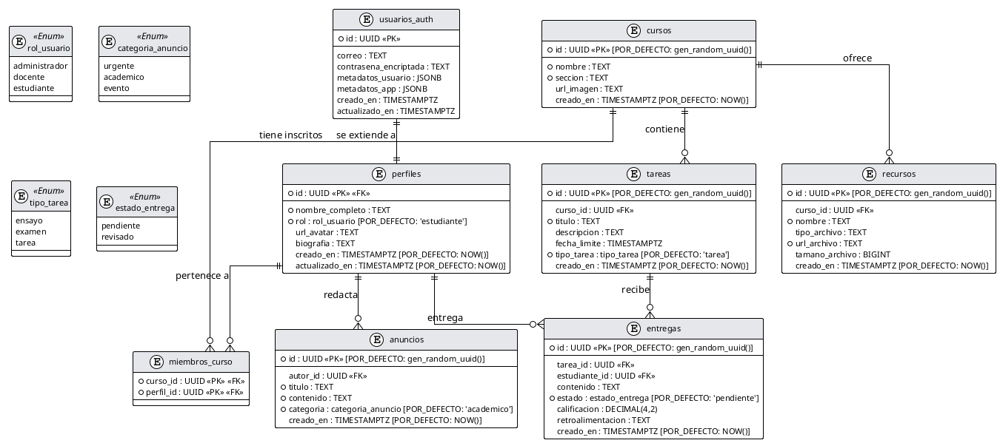

# 📊 Modelo Relacional de la Base de Datos - Infotarea

Este documento describe de manera exhaustiva el modelo relacional de la base de datos de **Infotarea**, una plataforma modular de gestión de tareas y comunicación escolar desarrollada con Next.js y Supabase.

El diseño sigue las mejores prácticas de integridad referencial, tipado estricto mediante enumeraciones (`ENUM`) y extensión segura del esquema de autenticación nativo de Supabase (`usuarios_auth`).

---

## 📐 Diagrama en PlantUML

Puedes copiar el código siguiente para renderizar el diagrama en cualquier editor compatible con **PlantUML** (como VS Code con extensión PlantUML, o el servidor oficial [PlantUML Online](https://www.plantuml.com/plantuml/)):

---

## 🗂️ Detalle de Entidades y Campos

### 1. `perfiles`
Esta tabla extiende el esquema de autenticación nativo de Supabase (`usuarios_auth`) almacenando la información pública y el rol específico de cada usuario.
*   **`id`** (`UUID`, Llave Primaria): Hace referencia a `usuarios_auth(id)` con eliminación en cascada.
*   **`nombre_completo`** (`TEXT`, Obligatorio): Nombre completo del usuario.
*   **`rol`** (`rol_usuario`, Obligatorio, Por defecto `'estudiante'`): Rol dentro del sistema (`administrador`, `docente` o `estudiante`).
*   **`url_avatar`** (`TEXT`, Opcional): Enlace a la imagen de perfil.
*   **`biografia`** (`TEXT`, Opcional): Breve biografía del usuario.
*   **`creado_en` / `actualizado_en`** (`TIMESTAMPTZ`, Por defecto `NOW()`): Registros de auditoría de tiempo.

### 2. `cursos`
Representa las asignaturas o aulas virtuales.
*   **`id`** (`UUID`, Llave Primaria): Identificador único autogenerado.
*   **`nombre`** (`TEXT`, Obligatorio): Nombre de la materia (ej. "Física Cuántica").
*   **`seccion`** (`TEXT`, Obligatorio): Sección o grupo (ej. "Grupo B").
*   **`url_imagen`** (`TEXT`, Opcional): Imagen representativa del curso.
*   **`creado_en`** (`TIMESTAMPTZ`, Por defecto `NOW()`): Fecha de creación.

### 3. `miembros_curso`
Tabla asociativa para gestionar la relación muchos-a-muchos ($N:M$) entre perfiles y cursos.
*   **`curso_id`** (`UUID`, Llave Primaria / Foránea): Referencia a `cursos(id)` con eliminación en cascada.
*   **`perfil_id`** (`UUID`, Llave Primaria / Foránea): Referencia a `perfiles(id)` con eliminación en cascada.

### 4. `tareas`
Tareas asignadas dentro de un curso en particular.
*   **`id`** (`UUID`, Llave Primaria): Identificador único autogenerado.
*   **`curso_id`** (`UUID`, Llave Foránea): Referencia a `cursos(id)` con eliminación en cascada.
*   **`titulo`** (`TEXT`, Obligatorio): Título de la tarea.
*   **`descripcion`** (`TEXT`, Opcional): Detalles de la actividad.
*   **`fecha_limite`** (`TIMESTAMPTZ`, Opcional): Fecha y hora límite de entrega.
*   **`tipo_tarea`** (`tipo_tarea`, Obligatorio, Por defecto `'tarea'`): Categoría de la tarea (`ensayo`, `examen`, `tarea`).
*   **`creado_en`** (`TIMESTAMPTZ`, Por defecto `NOW()`): Fecha de publicación.

### 5. `entregas`
Entregas realizadas por los estudiantes para resolver las tareas asignadas.
*   **`id`** (`UUID`, Llave Primaria): Identificador único autogenerado.
*   **`tarea_id`** (`UUID`, Llave Foránea): Referencia a `tareas(id)` con eliminación en cascada.
*   **`estudiante_id`** (`UUID`, Llave Foránea): Referencia a `perfiles(id)` con eliminación en cascada.
*   **`contenido`** (`TEXT`, Opcional): Texto de la entrega o enlace al archivo adjunto.
*   **`estado`** (`estado_entrega`, Obligatorio, Por defecto `'pendiente'`): Estado de la entrega (`pendiente`, `revisado`).
*   **`calificacion`** (`DECIMAL(4,2)`, Opcional): Calificación obtenida.
*   **`retroalimentacion`** (`TEXT`, Opcional): Retroalimentación provista por el docente.
*   **`creado_en`** (`TIMESTAMPTZ`, Por defecto `NOW()`): Fecha y hora de entrega.

### 6. `anuncios`
Anuncios generales publicados para toda la comunidad.
*   **`id`** (`UUID`, Llave Primaria): Identificador único autogenerado.
*   **`autor_id`** (`UUID`, Llave Foránea): Referencia a `perfiles(id)` con eliminación en cascada.
*   **`titulo`** (`TEXT`, Obligatorio): Título del anuncio.
*   **`contenido`** (`TEXT`, Obligatorio): Cuerpo del mensaje.
*   **`categoria`** (`categoria_anuncio`, Obligatorio, Por defecto `'academico'`): Categoría del aviso (`urgente`, `academico`, `evento`).
*   **`creado_en`** (`TIMESTAMPTZ`, Por defecto `NOW()`): Fecha de publicación.

### 7. `recursos`
Recursos complementarios (PDFs, enlaces, diapositivas) asociados a un curso.
*   **`id`** (`UUID`, Llave Primaria): Identificador único autogenerado.
*   **`curso_id`** (`UUID`, Llave Foránea): Referencia a `cursos(id)` con eliminación en cascada.
*   **`nombre`** (`TEXT`, Obligatorio): Nombre del archivo o recurso.
*   **`tipo_archivo`** (`TEXT`, Opcional): Tipo de archivo (ej. `application/pdf`, `image/png`).
*   **`url_archivo`** (`TEXT`, Obligatorio): Enlace directo de descarga o visualización en Supabase Storage.
*   **`tamano_archivo`** (`BIGINT`, Opcional): Tamaño del archivo en bytes.
*   **`creado_en`** (`TIMESTAMPTZ`, Por defecto `NOW()`): Fecha de registro.

---

## ⚙️ Tipos Enumerados (`ENUM`)

El sistema implementa 4 tipos enumerados para garantizar la consistencia en el estado de los datos:
1.  **`rol_usuario`**: Define los niveles de acceso del sistema:
    *   `administrador`: Gestión de usuarios, perfiles y toda la plataforma.
    *   `docente`: Creador de cursos, tareas, recursos, anuncios y evaluador de entregas.
    *   `estudiante`: Visualizador de cursos/recursos y realizador de entregas de tareas.
2.  **`categoria_anuncio`**: Tipifica los anuncios escolares:
    *   `urgente`: Avisos de máxima prioridad.
    *   `academico`: Avisos relacionados con planes de estudio o clases.
    *   `evento`: Festividades, reuniones o actividades extracurriculares.
3.  **`tipo_tarea`**: Tipo de evaluación de las tareas:
    *   `ensayo`: Ensayos, escritos o composiciones.
    *   `examen`: Evaluaciones formales o cuestionarios.
    *   `tarea`: Tareas diarias o de práctica.
4.  **`estado_entrega`**: Estado del flujo de evaluación:
    *   `pendiente`: Entregado por el alumno, esperando revisión.
    *   `revisado`: Calificado y retroalimentado por el docente.

---

## 💬 Entidades de Comunicación (Iteración Nº 3)

### 8. `communication_messages` (HU-12 & HU-13)
Gestión de hilos de chat y mensajería en tiempo real entre Docente-Estudiante y Administrador-Docente.
*   **`id`** (`UUID`, Llave Primaria): Identificador único.
*   **`sender_id`** (`UUID`, Llave Foránea): Referencia a `perfiles(id)`.
*   **`receiver_id`** (`UUID`, Opcional): Referencia a `perfiles(id)` para mensajes directos.
*   **`course_id`** (`UUID`, Opcional): Referencia a `cursos(id)` para contexto pedagógico.
*   **`channel_type`** (`TEXT`): Tipo de canal (`teacher_student`, `admin_teacher`, `student_parent`).
*   **`title`** (`TEXT`, Opcional): Título para circulares o comunicados.
*   **`content`** (`TEXT`, Obligatorio): Texto del mensaje o circular.
*   **`is_read`** (`BOOLEAN`, Por defecto `false`): Estado de lectura.
*   **`created_at`** (`TIMESTAMPTZ`, Por defecto `NOW()`): Marca de tiempo del mensaje.

### 9. `parent_student_links` (HU-14)
Habilitación progresiva del flujo familiar Estudiante-Padre.
*   **`id`** (`UUID`, Llave Primaria): Identificador único.
*   **`student_id`** (`UUID`, Llave Foránea): Referencia a `perfiles(id)`.
*   **`parent_name`** (`TEXT`): Nombre del apoderado o tutor legal.
*   **`parent_email`** (`TEXT`): Correo de contacto del apoderado.
*   **`parent_phone`** (`TEXT`): Teléfono o WhatsApp de contacto.
*   **`invite_code`** (`TEXT`, Único): Clave familiar de vinculación (`PADRE-XXXX-2026`).
*   **`progressive_stage`** (`INT`, [1, 3]): Fase actual (1: Vinculación, 2: Permisos de Avance, 3: Canal Activo).
*   **`status`** (`TEXT`): Estado (`pending`, `linked`, `active`).
*   **`share_grades`** / **`share_tasks`** (`BOOLEAN`): Alcance de visibilidad otorgado.

---

## 🧠 Entidades de Priorización, Alertas y Correo (Iteración Nº 4)

### 10. `notification_rules` (Ítem 21)
Reglas configurables por la dirección para la generación de avisos: ventanas de anticipación y umbrales de riesgo.
*   **`rule_key`** (`TEXT`, Llave Primaria): Tipo de alerta (`task_due_soon`, `task_overdue`, `submission_pending_review`, `student_at_risk`, `weekly_summary`).
*   **`label`** / **`description`** (`TEXT`): Nombre y explicación visibles en la plataforma.
*   **`enabled`** (`BOOLEAN`, Por defecto `true`): Activa o apaga la generación de ese aviso.
*   **`config`** (`JSONB`): Parámetros de la regla (`hours`, `average`, `overdue`).
*   **`updated_at`** (`TIMESTAMPTZ`): Última modificación.

### 11. `email_settings` (Ítem 23)
Cuenta de correo saliente de la institución (una sola fila, `id = true`). Nunca guarda la contraseña.
*   **`id`** (`BOOLEAN`, Llave Primaria): Fila única forzada con `CHECK (id)`.
*   **`enabled`** (`BOOLEAN`): Interruptor "Enviar correos".
*   **`smtp_host`** / **`smtp_port`** / **`smtp_security`** (`TEXT`/`INTEGER`/`TEXT`): Servidor, puerto y cifrado (`tls`, `ssl`, `none`).
*   **`smtp_user`** / **`from_email`** / **`from_name`** / **`reply_to`** (`TEXT`): Credenciales de envío y remitente visible.
*   **`alert_config`** (`JSONB`): Qué tipos de alerta se envían por correo.
*   **`updated_by`** (`UUID`): Referencia a `perfiles(id)`.

### 12. `email_secrets` (Ítem 23)
Contraseña de aplicación SMTP. RLS habilitado **sin políticas**: solo la clave de servicio o una conexión directa de confianza puede leerla; nunca llega al navegador.
*   **`id`** (`BOOLEAN`, Llave Primaria): Fila única forzada con `CHECK (id)`.
*   **`smtp_password`** (`TEXT`): Contraseña de aplicación (se guarda sin espacios).
*   **`updated_at`** (`TIMESTAMPTZ`): Última modificación.

### 13. `email_log` (Ítem 23)
Bitácora de envíos de correo (pruebas y alertas) para auditoría y diagnóstico.
*   **`id`** (`UUID`, Llave Primaria): Identificador único.
*   **`alert_ids`** (`UUID[]`): Alertas incluidas en el envío.
*   **`to_email`** / **`subject`** (`TEXT`): Destinatario y asunto.
*   **`kind`** (`TEXT`): `test`, `alert_digest`, `weekly_summary` o `password_reset`.
*   **`status`** (`TEXT`): `sent` o `failed`.
*   **`error_message`** / **`provider_message_id`** (`TEXT`, Opcional): Diagnóstico del proveedor.
*   **`created_at`** (`TIMESTAMPTZ`): Fecha del envío.

### 14. `smart_alerts` (Ítems 21–23)
Alertas inteligentes generadas por el motor de reglas; visibles en la plataforma y enviadas por correo cuando está activo.
*   **`id`** (`UUID`, Llave Primaria): Identificador único.
*   **`alert_type`** (`TEXT`): Tipo de aviso (ver `notification_rules`).
*   **`severity`** (`TEXT`): `critica`, `alta`, `media` o `informativa`.
*   **`title`** / **`message`** (`TEXT`): Texto visible para el usuario.
*   **`student_id`** / **`task_id`** / **`course_id`** (`UUID`, Opcional): Referencias a `perfiles(id)`, `tareas(id)` y `cursos(id)`.
*   **`metadata`** (`JSONB`): Datos de apoyo (estudiantes pendientes, promedio, semana, etc.).
*   **`dedupe_key`** (`TEXT`, Único): Clave que impide avisos repetidos (`overdue:<tarea>`, `due_soon:<tarea>:<día>`, `at_risk:<estudiante>:<semana>`, …).
*   **`status`** (`TEXT`): `pending`, `sent`, `failed` o `read`.
*   **`email_status`** (`TEXT`): `not_sent`, `sent` o `failed`.
*   **`sent_at`** / **`created_at`** / **`updated_at`** (`TIMESTAMPTZ`): Trazabilidad del aviso.

> Políticas RLS: la dirección gestiona todo; los docentes ven las alertas de sus cursos y de sus estudiantes; los estudiantes solo ven las propias.

### 15. `password_reset_requests` (Ítem 23 ampliado)
Auditoría y control de abuso de la recuperación de contraseña desde el inicio de sesión. Nunca guarda el token ni la contraseña.
*   **`id`** (`UUID`, Llave Primaria): Identificador único.
*   **`email`** (`TEXT`): Correo que solicitó el enlace (en minúsculas).
*   **`requester_hash`** (`TEXT`, Opcional): Hash no reversible del solicitante (IP) para limitar el abuso sin almacenar la dirección real.
*   **`delivered_via`** (`TEXT`): `app_smtp` (cuenta Gmail de la institución), `supabase_auth` (correo estándar de respaldo) o `skipped`.
*   **`created_at`** (`TIMESTAMPTZ`): Fecha de la solicitud.

> Políticas RLS: habilitado **sin políticas** (igual que `email_secrets`): la fila solo se escribe desde el servidor con acceso elevado. Límite operativo: 3 solicitudes por correo y 10 por solicitante cada hora.

